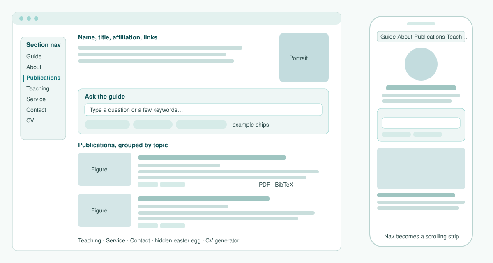

<p align="center">
  
</p>

<p align="center">
  <a href="LICENSE"></a>
  
  
  
</p>

**Wayfinder** is a template for an academic homepage in one static HTML file, laid out in the classic Jon Barron style. There is no framework, no build step and no server. The page makes no network requests at runtime.

Its main feature is the **Ask the guide** box. Visitors type a question or a few keywords, and the guide points them to the right section or to an approved external link. It does this without a language model, so there is nothing to prompt-inject.

You are welcome to fork it and build your own site. Everything in `index.html` and `papers/` is the author's own content. Replace it with yours before you publish.

---

## Contents

- [Layout](#layout)
- [Features](#features)
- [How Ask the guide works](#how-ask-the-guide-works)
- [Security design](#security-design)
- [Project structure](#project-structure)
- [Quick start](#quick-start)
- [Make it yours](#make-it-yours)
- [Deploy to GitHub Pages](#deploy-to-github-pages)
- [Custom domain](#custom-domain)
- [Checks and CI](#checks-and-ci)
- [License](#license)

## Layout

<p align="center"></p>

## Features

| | |
|---|---|
| **Ask the guide** | Takes full questions or bare keywords, in any language. It answers with pre-written text and links to page sections or allow-listed sites. If the topic is not on the page, it says so and points to your contact address. |
| **Grouped publications** | Papers are grouped by topic. Each entry has a figure, a short summary, venue rank tags, a link to a **local PDF** and one-click **BibTeX**. |
| **One-click CV** | Builds a printable CV from the same data as the page, so the two never drift apart. |
| **Floating section nav** | A side rail on wide screens. Below 1240 px it turns into a single-line strip that scrolls sideways. The current section is highlighted. |
| **Teaching and service** | Ready-made sections for units taught, organising roles, program committees, editorial work and reviewing. |
| **Easter egg** | A hidden "after hours" section with a small game. Change it or delete it. |
| **Responsive and accessible** | Tested on 10 desktop, tablet and phone profiles. Supports keyboard focus and respects `prefers-reduced-motion`. |
| **Zero runtime dependencies** | Everything is inlined, including the search library. |

## How Ask the guide works

Both layers run in the visitor's browser.

```
query ─► normalise ─► 1. intent matcher ──hit──► pre-written answer + allow-listed links
        (NFKD, strip      (keywords + char      │
         tags/bidi,        n-gram similarity)   └─miss─► 2. full-text search ──hit──► jump to section / paper
         ≤160 chars)                                        (MiniSearch BM25,            │
                                                             prefix + fuzzy)             └─miss─► "Not on this page, please get in touch"
```

1. **Intent matcher.** You write a set of intents by hand, for example research, students, collaboration, teaching and contact. The script also builds intents from the page data: one per paper, venue (with aliases), year and unit code. Each intent is scored by keyword hits plus character n-gram (Dice) similarity. Text is Unicode-folded first. Chinese, Japanese, Korean and Thai use character bigrams, so questions in those languages match without translation.
2. **Full-text search.** [MiniSearch](https://github.com/lucaong/minisearch) (v7.2, MIT) indexes every section and paper on the page. Short keyword queries such as `security paper` or `privacy 2024` are answered here. A result must cover enough of the query's terms, so one common word does not pull in noise.
3. **Fallback.** If neither layer is confident, the guide does not guess. It says the topic is not on the page and points to your contact address.

Answers are fixed text. Nothing is generated.

## Security design

The box accepts free text from anyone, so it is locked down:

- **No model, no server.** Input can only *select* a pre-written answer. It is never executed, sent anywhere or echoed back as HTML.
- **Strict CSP** in a `<meta>` tag: `connect-src 'none'` and `worker-src 'none'`, and scripts can only come from the page itself.
- **`textContent` rendering.** Nothing a visitor types is written with `innerHTML`.
- **Link allow-list.** Answers can only link to in-page anchors (`#section-id`) or HTTPS hosts in `ALLOWED_HOSTS`. `safeHref` drops anything else.
- **Input hygiene.** Queries are capped at 160 characters, and tags and bidi control characters are removed.
- **No analytics, no cookies, no third-party fonts.**

## Project structure

```
.
├── index.html                 # the whole site: content data, styles, guide, search, CV generator
├── papers/                    # local PDFs, one per paper (<KEY>.pdf)
├── assets/
│   ├── avatar.webp            # portrait (also inlined in index.html)
│   ├── banner.svg             # README banner
│   └── layout.svg             # README layout sketch
├── tools/
│   └── check_site.py          # pre-deploy checks, run in CI
├── .github/workflows/
│   └── deploy.yml             # check, then build _site and deploy to Pages
├── .nojekyll
└── LICENSE
```

## Quick start

```bash
git clone https://github.com/<you>/<your-repo>.git
cd <your-repo>
python3 -m http.server 8000
# open http://localhost:8000
```

Nothing needs installing. Opening `index.html` directly also works, but a local server is closer to how Pages serves the site.

## Make it yours

All content lives as plain JavaScript data near the top of the `<script>` block in `index.html`. Start by deleting the existing content.

1. **Basics.** Edit the header (name, title, affiliation, links) and the About, Research and Contact sections. Replace `assets/avatar.webp` and the inlined avatar.
2. **Publication topics.** Set your own topic list in `CATS`, and venue rank tags in `RANK`. Remove `RANK` if you don't need rank tags.
3. **Papers.** For each paper:
   - put the PDF at `papers/<KEY>.pdf`;
   - add an entry to the `P` array with key, title, venue, year, topic, summary and BibTeX;
   - add `<KEY>` to `LOCAL_PDF` so the PDF link appears;
   - optionally add venue aliases to `VENUE_ALIASES`.

   The guide picks up each new paper, venue and year automatically.
4. **Teaching.** Edit `TEACH`, giving each unit's code, name and term.
5. **Service.** Edit the lists under `#service`.
6. **Guide answers.** Edit `INTENTS`. Each intent has keywords (`kw`), example questions (`ex`), an answer, and destination links taken from `DEST`. Add the host of every external link to `ALLOWED_HOSTS`, and change the fallback email.
7. **CV.** Edit the `CV` object. The generator reads it together with the paper list.
8. **Easter egg.** Rewrite or delete the `#after-hours` section.

Run `python3 tools/check_site.py` after each round of edits.

## Deploy to GitHub Pages

The workflow in `.github/workflows/deploy.yml` deploys on every push to `main`. It runs only the checks on pull requests, and you can also start it by hand.

1. **Repository name.** Name the repo `<you>.github.io` to publish at `https://<you>.github.io/`. Any other name publishes at `https://<you>.github.io/<repo>/`. The site uses relative paths, so both work.
2. **Visibility.** Make the repo public. Pages on private repos needs a paid plan.
3. **Pages source.** Go to Settings → Pages → Build and deployment and set Source to **GitHub Actions**.
4. **First deploy.** Push a commit, or open Actions → Deploy site → Run workflow.

## Custom domain

1. Add a file named `CNAME` at the repo root. It should contain only the domain, for example `www.example.com`. The workflow copies it into the build.
2. Set up DNS with your domain provider:
   - **Subdomain** (such as `www.`): add a `CNAME` record pointing to `<you>.github.io`.
   - **Apex domain** (`example.com`): add `A` records for `185.199.108.153`, `185.199.109.153`, `185.199.110.153` and `185.199.111.153`. Optionally add `AAAA` records for IPv6.
3. In Settings → Pages → Custom domain, enter the same domain. Tick **Enforce HTTPS** once the certificate is ready.

## Checks and CI

`tools/check_site.py` runs before every deploy. It fails the build if:

- `index.html` does not parse;
- a required section id (`guide`, `about`, `publications`, `teaching`, `service`, `contact`, `cv`, …) is missing;
- a PDF listed in `LOCAL_PDF` is missing or suspiciously small;
- two papers share a key;
- a guide link points to an anchor that does not exist.

## License

The **code** (HTML structure, CSS, JavaScript, the workflow and tools) is MIT licensed. See [LICENSE](LICENSE).

The **content** is not covered by the MIT licence. This means the text of the site, the portrait, and the papers in `papers/`. The papers remain under their publishers' or authors' terms. Please replace all of it with your own.

The inlined [MiniSearch](https://github.com/lucaong/minisearch) library is © Luca Ongaro, MIT License.
