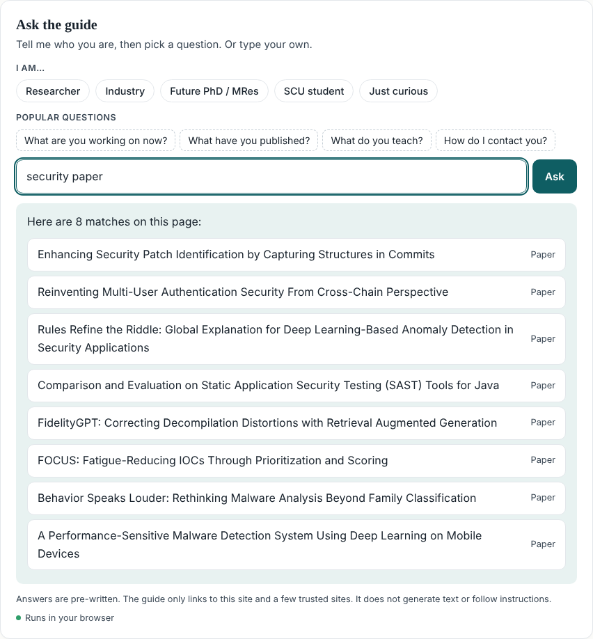
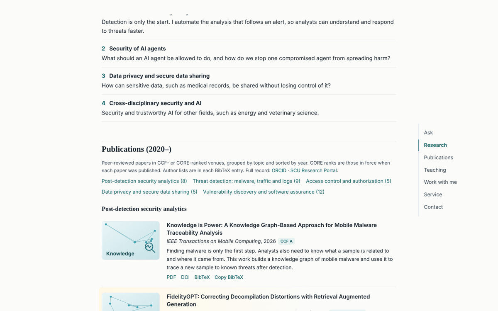

<p align="center">
  
</p>

<p align="center">
  <a href="https://github.com/rtfeng/Interactive-Personal-Site/actions/workflows/deploy.yml"></a>
  <a href="LICENSE"></a>
  
  
</p>

<p align="center">
  <b><a href="https://rtfeng.github.io/Interactive-Personal-Site/">Visit the live site</a></b>
  &nbsp;|&nbsp; <a href="https://scholar.google.com/citations?user=ev-Zbf4AAAAJ">Google Scholar</a>
  &nbsp;|&nbsp; <a href="mailto:ruitao.feng@scu.edu.au">ruitao.feng@scu.edu.au</a>
</p>

This is the academic homepage of Ruitao Feng. It is one static HTML file with no framework, no build step and no external requests at runtime. The layout follows Jon Barron's well-known style. It adds one thing that page does not have: an **Ask the guide** box that sends visitors to the right section or link without calling a server or a language model.

---

## Contents

- [Screenshots](#screenshots)
- [Features](#features)
- [How Ask the guide works](#how-ask-the-guide-works)
- [Security design](#security-design)
- [Project structure](#project-structure)
- [Run it locally](#run-it-locally)
- [Deploy to GitHub Pages](#deploy-to-github-pages)
- [Custom domain](#custom-domain)
- [Updating content](#updating-content)
- [Checks and CI](#checks-and-ci)
- [License](#license)

## Screenshots

<table>
  <tr>
    <td width="62%"></td>
    <td width="38%" rowspan="2" valign="top"></td>
  </tr>
  <tr>
    <td></td>
  </tr>
  <tr>
    <td colspan="2"></td>
  </tr>
</table>

<sub>Top left: desktop. Right: iPhone 13. Middle: the guide answering the keyword query <code>security paper</code>. Bottom: publications grouped by research area.</sub>

## Features

| | |
|---|---|
| **Ask the guide** | Visitors can type a full question or a few keywords in any language. Each answer comes with links to page sections or approved external sites. If something is not on the page, the guide says so and gives an email contact. |
| **Publications (2020–)** | Papers are grouped by research area. Each has a figure, a short summary, its CCF and CORE rank (the CORE rank in force at publication), a link to a **local PDF**, and one-click **BibTeX**. |
| **One-click CV** | Generates a printable CV from the page data. It contains a research summary and paper titles with venues since 2020. |
| **Floating section nav** | A side rail on wide screens. Below 1240 px it becomes a single-line strip that scrolls sideways. The current section is highlighted. |
| **Teaching and service** | Units for the current year with unit code and term, organising and PC roles, editorial work, and reviewing. |
| **After hours** | A hidden easter egg. Finding it is part of the fun. |
| **Responsive and accessible** | Tested on 10 desktop, tablet and phone profiles. Supports keyboard focus and respects `prefers-reduced-motion`. |
| **Zero dependencies at runtime** | Everything, including the search library, is inlined. The page makes no network calls of its own. |

## How Ask the guide works

The guide has two layers. Both run in the visitor's browser.

```
query ─► normalise ─► 1. intent matcher ──hit──► pre-written answer + whitelisted links
        (NFKD, strip      (keywords + char      │
         tags/bidi,        n-gram similarity)   └─miss─► 2. full-text search ──hit──► jump to section / paper
         ≤160 chars)                                        (MiniSearch BM25,            │
                                                             prefix + fuzzy)             └─miss─► "Not on this page, email me"
```

1. **Intent matcher.** This layer holds a hand-written set of intents: research directions, students, collaboration, teaching, contact, service and others. It also generates intents from the page data: one for each paper, venue (with aliases such as `CCS`, `TDSC`), year and unit code. Each intent is scored by keyword hits plus character n-gram (Dice) similarity. The text is Unicode-folded first. Chinese, Japanese, Korean and Thai use character bigrams, so a question like `你教什么课` works without any translation.
2. **Full-text search.** [MiniSearch](https://github.com/lucaong/minisearch) (v7.2, MIT) indexes every section and paper on the page. Short keyword queries such as `security paper`, `malware 2024` or `privacy` land here. A hit must cover enough of the query terms, so a single common word does not pull in noise.
3. **Fallback.** If neither layer is confident, the guide does not guess. It says the topic is not on the page and points to email.

Answers are always in English and are fixed text. Nothing is generated.

## Security design

The box takes free text from strangers, so it is restricted by design:

- **No model, no server.** There is nothing to prompt-inject. Input can only *select* a pre-written answer; it is never executed or echoed back as HTML.
- **Strict CSP** (in a `<meta>` tag): `connect-src 'none'`, `worker-src 'none'`, scripts only from the page itself.
- **Rendering via `textContent` only.** No `innerHTML` is used for anything a visitor types.
- **Link whitelist.** Answers can link only to in-page anchors (`#section-id`) or HTTPS hosts on a fixed allow-list. Everything else is dropped by `safeHref`.
- **Input hygiene.** Queries are capped at 160 characters, with tags and bidi control characters removed.
- **No analytics, no cookies, no third-party fonts.**

## Project structure

```
.
├── index.html                 # the whole site: content data, styles, guide, search, CV generator
├── papers/                    # local PDFs, one per paper (<KEY>.pdf)
├── assets/
│   ├── avatar.webp            # portrait (also inlined in index.html)
│   ├── banner.svg             # README banner
│   └── screenshots/           # README screenshots
├── tools/
│   └── check_site.py          # pre-deploy checks (run in CI)
├── .github/workflows/
│   └── deploy.yml             # check → build _site → deploy to Pages
├── .nojekyll
└── LICENSE
```

## Run it locally

No install needed.

```bash
git clone https://github.com/rtfeng/Interactive-Personal-Site.git
cd Interactive-Personal-Site
python3 -m http.server 8000
# open http://localhost:8000
```

Opening `index.html` directly also works. A local server is closer to how Pages serves it.

## Deploy to GitHub Pages

The workflow in `.github/workflows/deploy.yml` runs on every push to `main`. It also runs on pull requests (checks only) and can be started by hand.

One-time setup:

1. **Make the repo public** (Settings → General → Danger zone → Change visibility). Pages on private repos needs a paid plan.
2. **Settings → Pages → Build and deployment → Source: _GitHub Actions_.**
3. Open **Actions → Deploy site → Run workflow** (or push any commit).

The site will be live at `https://rtfeng.github.io/Interactive-Personal-Site/`.

## Custom domain

1. Add a file named `CNAME` at the repo root containing only the domain, for example `www.ruitaofeng.com`. The workflow copies it into the build automatically.
2. At your DNS provider:
   - **Subdomain** (`www.` or similar): a `CNAME` record pointing to `rtfeng.github.io`.
   - **Apex domain** (`ruitaofeng.com`): `A` records to `185.199.108.153`, `185.199.109.153`, `185.199.110.153`, `185.199.111.153` (plus `AAAA` records if you want IPv6).
3. Settings → Pages → Custom domain: enter the same domain. Tick **Enforce HTTPS** once the certificate is issued.

## Updating content

All content is plain JavaScript data near the top of the `<script>` in `index.html`.

**Add a paper**

1. Put the PDF at `papers/<KEY>.pdf`.
2. Add an entry to the `P` array: key, title, venue, year, category (`analytics`, `malware`, `access`, `privacy`, `vuln`), summary and BibTeX.
3. Add `<KEY>` to the `LOCAL_PDF` set so the PDF link appears.
4. If the venue is new, add its rank to `RANK` and optionally aliases to `VENUE_ALIASES`.

The guide picks up the new paper, its venue and its year automatically.

**Teaching.** Edit `TEACH`, giving the unit code, name and term for each unit.

**Service.** Edit the lists under `#service`. The guide's `chairs`, `pc`, `editorial` and `reviewing` intents read from them.

**Guide answers.** Edit the `INTENTS` array. Each intent has `kw` (keywords), `ex` (example questions), an answer and destination links from `DEST`. External links must use a host in `ALLOWED_HOSTS`.

**CV.** The generator reads the `CV` object plus the paper list, so it stays in sync.

## Checks and CI

`tools/check_site.py` runs before every deploy and fails the build if:

- `index.html` does not parse;
- a required section id (`guide`, `about`, `publications`, `teaching`, `service`, `contact`, `cv`, …) is missing;
- a PDF listed in `LOCAL_PDF` is missing or suspiciously small;
- two papers share a key;
- a guide link points to an anchor that does not exist.

Run it yourself with:

```bash
python3 tools/check_site.py
```

## License

The **code** (HTML structure, CSS, JavaScript, workflow and tools) is released under the [MIT License](LICENSE). You are welcome to fork it for your own homepage. Please replace the content with your own.

**Not covered** by the MIT License:

- the papers in `papers/`, which remain under their publishers' or authors' terms;
- the portrait and the written text of the site.

The inlined [MiniSearch](https://github.com/lucaong/minisearch) library is © Luca Ongaro, MIT License.
